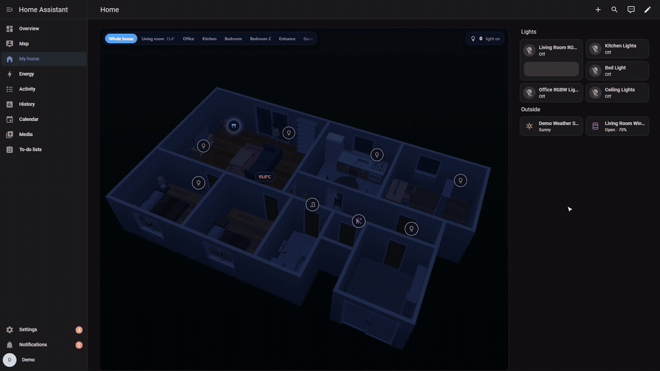
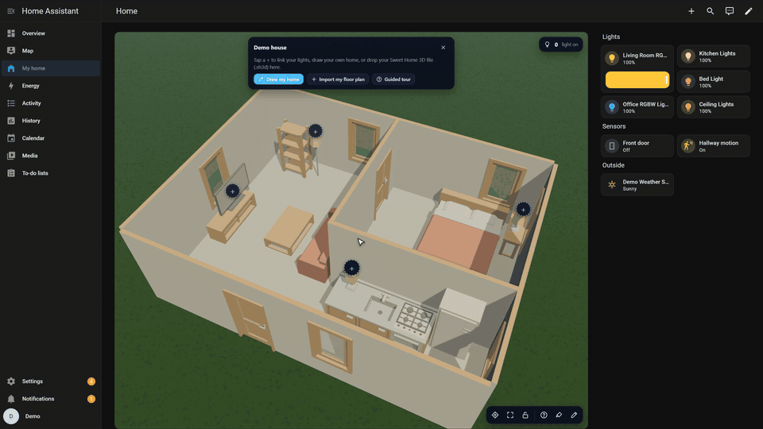
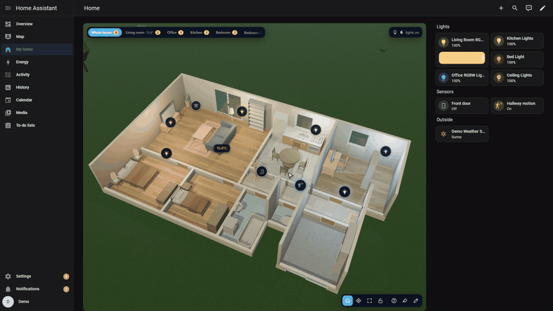
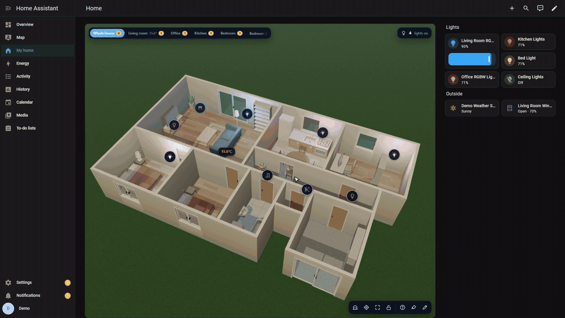
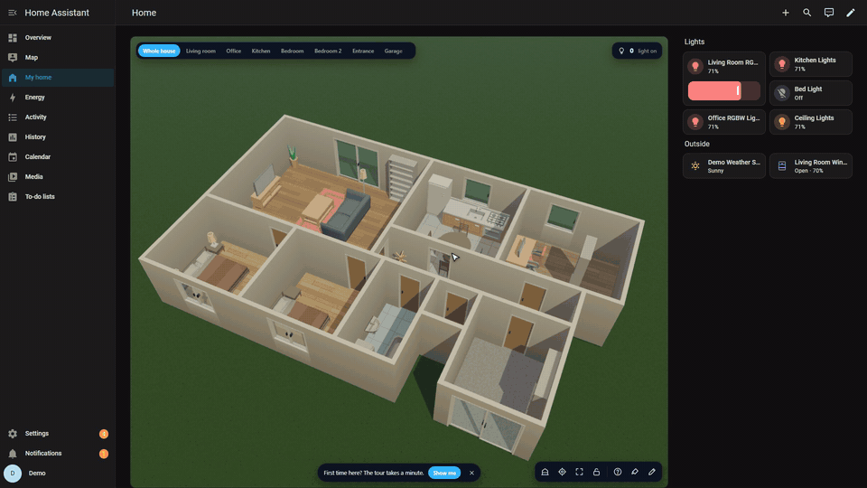
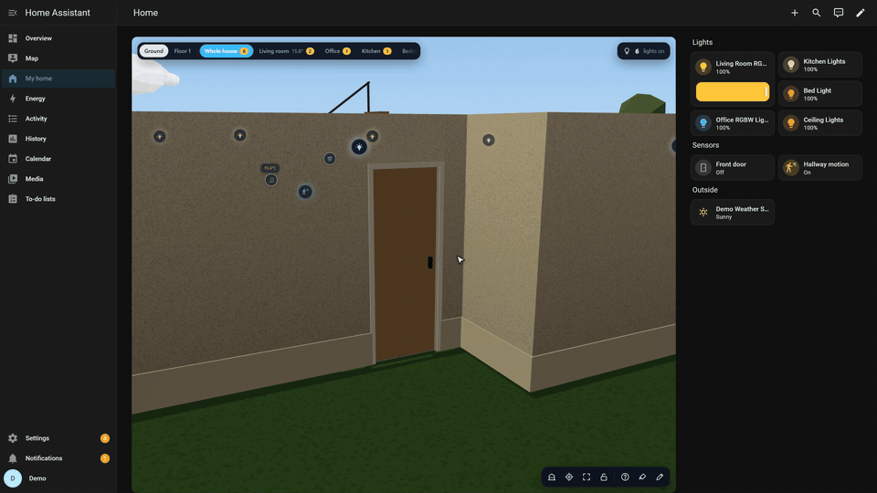
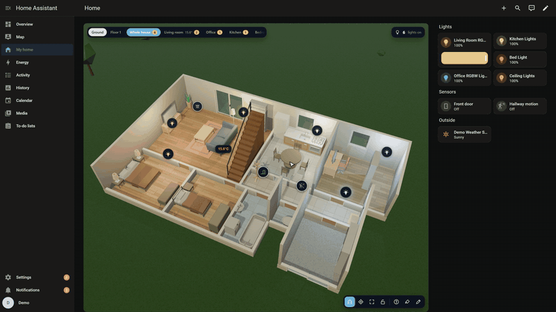
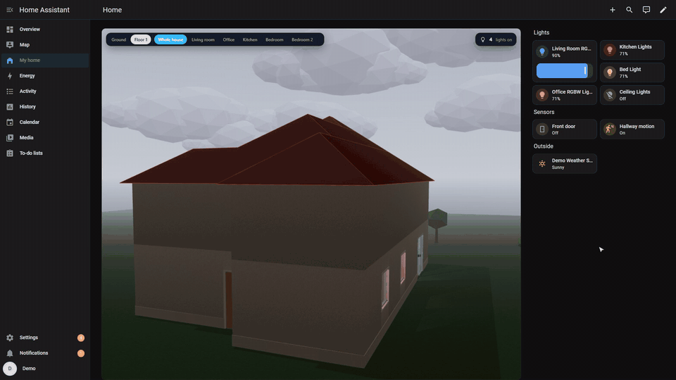

<p align="center">
  
</p>

<h1 align="center">Owlnest</h1>

<p align="center">
  <strong>A 3D floorplan for Home Assistant.</strong><br />
  Your lights and devices in a model of your home, with an editor to place them.
</p>

<p align="center">
  <a href="https://github.com/MestrieEsteban/ha-owlnest/releases/latest"></a>
  <a href="#installation"></a>
  <a href="https://github.com/MestrieEsteban/ha-owlnest/issues"></a>
  <a href="LICENSE"></a>
</p>

<p align="center">
  <a href="https://mestrieesteban.github.io/ha-owlnest/?lang=en"></a>
</p>

<p align="center">
  <a href="https://mestrieesteban.github.io/ha-owlnest/?lang=en"><strong>▶ Live demo</strong></a> ·
  <a href="#installation">Install</a> ·
  <a href="#quick-start">Try it</a> ·
  <a href="docs/guide.md">Full guide</a> ·
  <a href="https://www.youtube.com/watch?v=_MbcDL5JaTE">Video demo</a> ·
  <a href="README-FR.md">Français</a>
</p>

<p align="center">
  <a href="https://www.youtube.com/watch?v=_MbcDL5JaTE">
    
  </a>
</p>

Owlnest is a Home Assistant card that displays your home in 3D. Lights in the model follow your actual lamps: on/off, colour and brightness. You can also place sensors and have doors or shutters move with their entity's state.

**Draw your home right in the card:** rooms, doors and windows, floors and stairs, furniture, then pick a style. No Blender, no model to make anywhere else. Already have a Sweet Home 3D file? Drop it on the card and it becomes an editable plan.

<p align="center">
  
</p>

## Why Owlnest?

3D floorplan solutions for Home Assistant rely on static Blender renders: one image per light state, a new render for every colour or condition. Nothing interactive, nothing alive.

I wanted something else: real-time 3D lights, a visual editor, weather, animations. Everything I wished I could find. And I thought others might be looking for the same thing, so I shared it.

A demo house is included so you can try the card with your own lights before making a model of your home.

> **Beta:** the project is still in development. There are bugs, and settings may change. If something goes wrong, you can report it in the [issues](https://github.com/MestrieEsteban/ha-owlnest/issues).

## Features

| Feature | Details |
|---|---|
| Draw | A plan editor in the card: rooms, walls, doors, windows, open-plan boundaries, templates, a picture to trace over, and more than 200 pieces of furniture. |
| Floors and stairs | Several floors stacked in 3D; straight, L, U or spiral stairs, with an opening and a railing upstairs. |
| Look | Ready-made house styles, facades (render, brick, timber, stone), a pitched roof, a garden, and a sky that follows the weather and the time of day. |
| Import | Drop a Sweet Home 3D file (`.sh3d`, or its OBJ export) or a `.glb` on the card. Doors and windows are found and set up for you. |
| Lights | On/off, brightness and colour synchronized with `light.*` entities. |
| Doors and windows | Swinging, sliding, tilt-and-turn, extending, or playback of animations in the GLB. |
| Sensors | Values displayed wherever you place their anchors. |
| Controls | Tap an anchor to control the device, hold it to open its details. The action depends on the entity type. |
| Rules | Move the camera, highlight an anchor or show a message based on an entity's state. |
| Weather and sun | Lighting from `sun.sun`; rain, snow, fog and storms from your weather entity. |
| Walls | Walls up with the roof, cutaway, ghost walls or walls down. |
| Navigation | Mouse, touch, a rooms bar to fly to a room, and saved viewpoints. |

Anchors support `light`, `switch`, `sensor`, `binary_sensor`, `cover`, `climate` and `media_player`. The interface is available in English and French.

## In action

Every clip below was recorded in a real Home Assistant, with its demo devices.

<table>
  <tr>
    <th colspan="2">Draw your home</th>
  </tr>
  <tr>
    <td colspan="2" align="center"></td>
  </tr>
  <tr>
    <td colspan="2">Start from a template or a blank page, add doors and windows, push walls, pick floors. The 3D follows as you draw. <a href="docs/guide.md#drawing-your-home">Plan guide →</a></td>
  </tr>
  <tr>
    <th>Floors and stairs</th>
    <th>A style in one tap</th>
  </tr>
  <tr>
    <td></td>
    <td></td>
  </tr>
  <tr>
    <td>Add a floor and place stairs: the floor above gets its opening. <a href="docs/guide.md#floors-and-stairs">Floors guide →</a></td>
    <td>Brick, timber, stone or render, a roof and a garden. <a href="docs/guide.md#look">Look guide →</a></td>
  </tr>
  <tr>
    <th>Your devices, room by room</th>
    <th>Doors and windows</th>
  </tr>
  <tr>
    <td></td>
    <td></td>
  </tr>
  <tr>
    <td>One tap places the devices of each Home Assistant area in the plan room of the same name. <a href="docs/guide.md#anchors">Devices guide →</a></td>
    <td>A door, a window or a shutter moves with its entity. <a href="docs/guide.md#openings">Openings guide →</a></td>
  </tr>
  <tr>
    <th>Rooms, views and rules</th>
    <th>Weather, sky and night</th>
  </tr>
  <tr>
    <td></td>
    <td></td>
  </tr>
  <tr>
    <td>Fly to a room in one tap. A rule can bring the camera to the entrance when someone walks in. <a href="docs/guide.md#rules-engine">Rules guide →</a></td>
    <td>The sky follows your weather entity and the sun. At night, lit rooms glow from outside. <a href="docs/guide.md#environment">Environment guide →</a></td>
  </tr>
</table>

<p align="center">
  <a href="https://mestrieesteban.github.io/ha-owlnest/?lang=en"></a>
</p>

## Installation

**Requires Home Assistant 2024.1 or later.** Owlnest installs as an integration and includes its Lovelace card. The card is registered automatically.

### With HACS

The fastest way: these two buttons open your own Home Assistant on the right page. [▶ Watch the installation video](https://www.youtube.com/watch?v=iBREyrejHSo) (1 min 30).

[](https://my.home-assistant.io/redirect/hacs_repository/?owner=MestrieEsteban&repository=ha-owlnest&category=integration)

[](https://my.home-assistant.io/redirect/config_flow_start/?domain=owlnest)

1. Click the first button, confirm adding the repository, then **Download**.
2. **Restart Home Assistant**.
3. Click the second button and confirm.
4. Force-reload your browser with **Ctrl+Shift+R** (**Cmd+Shift+R** on macOS).

<details>
<summary><strong>Without the buttons</strong></summary>

1. In **HACS**, open **⋮ → Custom repositories**.
2. Add `https://github.com/MestrieEsteban/ha-owlnest` and select **Integration** as the category.
3. Search for **Owlnest** in HACS and download it.
4. **Restart Home Assistant**.
5. Go to **Settings → Devices & Services → Add Integration**, search for **Owlnest** and confirm.
6. Force-reload your browser with **Ctrl+Shift+R** (**Cmd+Shift+R** on macOS).

</details>

> Choose the **Integration** category in HACS. The card is bundled inside the integration; there is no separate card download or Lovelace resource to add.

<details>
<summary><strong>Manual installation</strong></summary>

1. Download the source archive of the [latest release](https://github.com/MestrieEsteban/ha-owlnest/releases/latest).
2. Copy its `custom_components/owlnest/` folder into your Home Assistant `config/custom_components/` directory, including the `frontend/` folder.
3. Restart Home Assistant.
4. Add **Owlnest** from **Settings → Devices & Services → Add Integration**.
5. Force-reload your browser.

The card and demo model are included in the integration folder.

</details>

## Quick start

### Try the included demo house

After installation, edit a dashboard and add a **Manual** card:

```yaml
type: custom:ha-3d-floorplan
scene_id: owlnest_demo
```

Without a `model_url`, Owlnest loads the included house. Click a **+** marker on a lamp or the television and choose one of your Home Assistant entities. The link is saved automatically.

Try toggling a linked light. You can also drag to orbit, scroll to zoom, or use touch gestures to explore the house.

### Draw your own home

1. On the card, click **Draw my home** (or the pencil, then the **Plan** tab).
2. Start from a template, a blank page or a picture of your plan. Draw rooms with one drag, add doors and windows on the walls, push walls to the right size.
3. Add a floor from the floor bar, and stairs with the **Stairs** tool.
4. Name the rooms like your Home Assistant areas, then in **Devices**, choose **Place the devices of each room**.
5. In **Look**, pick a style. Everything is saved as you go.

### Already have a Sweet Home 3D file?

[▶ Watch the import video](https://www.youtube.com/watch?v=4hBuNCvALFA) (2 min). Drop your `.sh3d` file on the card: it becomes an editable plan with its walls, rooms, doors, windows, furniture and every level. The OBJ export (**3D view → Export to OBJ format**, as a folder, files or zip) still works and keeps the model exactly as drawn. Importing requires an administrator account. [Import guide →](docs/guide.md#importing-your-floor-plan)

<details>
<summary><strong>Using a GLB made elsewhere (Blender…)</strong></summary>

You can drop a `.glb` onto the card in the same way. To serve it yourself instead, place it in `config/www/models/` and set it in the card:

```yaml
type: custom:ha-3d-floorplan
scene_id: my_home
model_url: /local/models/house.glb
```

A plan imported from the card takes precedence over `model_url`.

</details>

**Editing tip:** in the plan, letters pick the tools (**R** room, **M** wall, **P** door, **F** window, **H** stairs, **N** furniture). In the 3D editor, press **G** to move a selected device, then **X**, **Y** or **Z** to constrain movement to an axis.

## Documentation

| Topic | Guide |
|---|---|
| Draw rooms, walls, doors and furniture | [Drawing your home](docs/guide.md#drawing-your-home) |
| Add floors and stairs | [Floors and stairs](docs/guide.md#floors-and-stairs) |
| Pick a style, a roof, a garden and a sky | [Look](docs/guide.md#look) |
| Import a Sweet Home 3D plan or a GLB | [Importing your floor plan](docs/guide.md#importing-your-floor-plan) |
| Navigate with mouse or touch | [Scene navigation](docs/guide.md#scene-navigation) |
| Configure devices, labels and visibility | [Anchors](docs/guide.md#anchors) |
| Animate doors, shutters or GLB animations | [Openings](docs/guide.md#openings) |
| Save viewpoints and move between them | [Camera views](docs/guide.md#camera-views) |
| Make the view react to entity states | [Rules engine](docs/guide.md#rules-engine) |
| Connect the sun and weather | [Environment](docs/guide.md#environment) |
| Adjust shadows, exposure and the scene's appearance | [Rendering and appearance](docs/guide.md#rendering-and-appearance) |
| Find shortcuts or card configuration | [Keyboard shortcuts](docs/guide.md#keyboard-shortcuts-edit-mode) · [YAML reference](docs/guide.md#full-yaml-reference) |

## Troubleshooting

<details>
<summary><strong>“Custom element doesn't exist: ha-3d-floorplan”</strong></summary>

Check that Owlnest was downloaded as an **Integration** in HACS, then restart Home Assistant and add it in **Settings → Devices & Services**. Force-reload the browser afterwards.

If the repository was added under another category, remove that HACS entry and add it again as **Integration**. For a manual installation, check that `custom_components/owlnest/frontend/ha-3d-floorplan.js` is present.

</details>

<details>
<summary><strong>My model doesn't appear</strong></summary>

If you dropped your plan on the card and it says the integration does not accept imports, update Owlnest in HACS and restart Home Assistant.

If you serve the model yourself, check that `config/www/models/house.glb` is accessible at `/local/models/house.glb` on your Home Assistant instance. The filename and `model_url` must match. For GLTF, keep any referenced textures and binary files accessible at their relative paths too.

If the file is accessible but still fails to load, check the browser console for the loading error.

</details>

<details>
<summary><strong>A light doesn't respond, or changes aren't saved</strong></summary>

For lights, check that the anchor is linked to the intended `light.*` entity and that the entity is available in **Developer Tools → States**.

For saving, check that the Owlnest integration is active and that a scene is selected with a `scene_id`. The editor's save indicator reports whether changes have been saved. Check the browser console for WebSocket errors if saving fails.

</details>

<details>
<summary><strong>The scene runs slowly, or the scale looks wrong</strong></summary>

In **Settings → Performance**, lower the quality level, and turn on **Show performance** to see how the device keeps up. For an imported model, reduce its polygon count and texture sizes.

Models can use metres, centimetres or inches: distance-dependent effects adapt to the model's overall size. If objects are out of proportion within the model, correct them in your 3D software before exporting.

</details>

## Contributing

To report a bug or suggest a feature, [open an issue](https://github.com/MestrieEsteban/ha-owlnest/issues). For bugs, include your Home Assistant and Owlnest versions, steps to reproduce the problem and any browser errors.

To work on the code, see [DEVELOPMENT.md](DEVELOPMENT.md) for local setup, testing and the Home Assistant development workflow. That guide is currently in French.

## License and credits

[MIT](LICENSE) · Esteban Mestrie.

The included demo house and the furniture catalogue use the [Furniture Kit](https://kenney.nl/assets/furniture-kit) by [Kenney](https://kenney.nl) and the [Ultimate Home Interior](https://quaternius.com/packs/ultimatehomeinterior.html) pack by Quaternius, all released under CC0.
